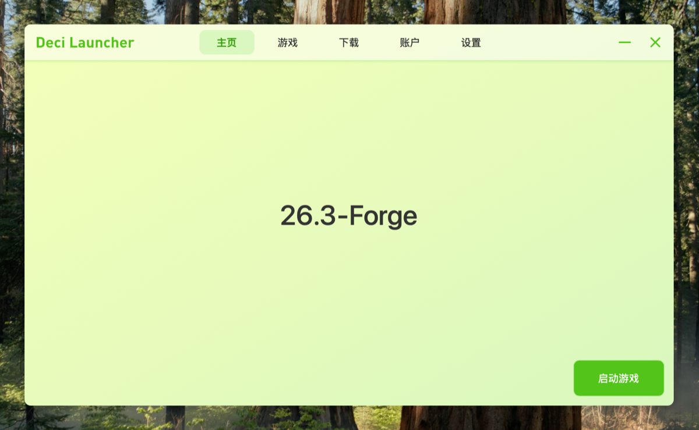

<p align="center">
  
</p>

<h1 align="center">Deci Launcher</h1>

<p align="center">
  <a href="https://github.com/tristanjen/DeciLauncher/actions/workflows/ci.yml">
    
  </a>
  <a href="LICENSE">
    
  </a>
  
  
  
</p>

<p align="center">
  <strong>English</strong> | <a href="README.zh-CN.md">简体中文</a>
</p>

Deci Launcher is a lightweight, cross-platform Minecraft launcher built with **C#/.NET 10 + Photino.NET** on the backend and **Vue 3 + Tailwind CSS + Reka UI** on the frontend, with Lucide icons and Animate.css transitions. It focuses on the core path — scan installed game versions, pick a Java runtime, launch the game — and adds native transparent windows, offline accounts, crash analysis, and a fully local, telemetry-free experience.

> **Beta**: the current version is defined by `<Version>` in [`DeciLauncher.csproj`](DeciLauncher.csproj).

<p align="center">
  
</p>

## Features

### Instances and launching

- **Installed version scanning** — reads `.minecraft/versions/` and detects vanilla as well as Fabric / Forge / NeoForge / Quilt versions.
- **Version isolation** — when a version directory contains its own `mods/` or `saves/`, game data stays inside that version directory; otherwise data is shared at the `.minecraft` root, matching the official launcher.
- **Staged launch progress** — the launch button shows live stages: parse version → find Java → launch → wait for the game window.
- **Cancel / close** — cancel an in-progress launch, or close a running game independently.
- **Closing the launcher does not close the game** — closing the launcher only cancels launches that have not finished; a running game keeps going. Only the "Close game" action terminates it.
- **Crash analysis** — on abnormal exit, parses the latest crash report and explains likely causes (memory, graphics driver, mod conflicts, Java version, …) in Chinese or English, with the tail of the game output attached.

### Java and accounts

- **Automatic Java detection** — scans `JAVA_HOME`, standard JDK locations (macOS `/Library/Java/JavaVirtualMachines`, Linux `/usr/lib/jvm`, …) and `PATH`, then matches the best runtime per game version. Warns when a manually selected Java is too old.
- **Offline accounts** — create, select, and delete offline accounts. UUIDs are generated deterministically from the username and stored locally.
- **Durable account storage** — accounts are written atomically with a `.bak` fallback for damaged files.

### UI and experience

- **Native transparent window** — chromeless custom title bar with a transparent background and rounded card on Windows and macOS; use `--opaque` to fall back to an opaque window.
- **Minimal green theme** — Tailwind CSS with semantic `deci-*` tokens, Reka UI primitives, Lucide icons, Animate.css transitions, and compact layouts.
- **Chinese and English UI** — built-in `zh-CN` / `en-US`, switchable in Settings.
- **Single instance** — a second launch reports "already running" and exits, preventing two instances from touching the same `.minecraft`.
- **Window dragging / minimizing / closing** — driven by the custom title bar through the native message bridge.

### Security and privacy

- **Local-only server** — in Release mode the frontend is served by embedded Kestrel bound to a random port on `127.0.0.1`.
- **Access token** — first navigation requires a URL token; a separate HttpOnly session cookie is issued afterwards. Requests without credentials receive 404.
- **No telemetry** — nothing is collected or uploaded. Logs stay on the machine and roll over three generations.
- **Local message bridge** — frontend and backend communicate over Photino's native message channel; no public ports are opened.

### Distribution

- **Self-contained single file** — every platform ships with the .NET runtime; users do not need to install .NET.
- **Windows** — single `.exe` (x64 / arm64).
- **Linux** — `.deb`, `.rpm`, `.AppImage` (x64 / arm64).
- **macOS** — `.app` + `.dmg` (x64 / arm64; the DMG includes an `Applications` shortcut).

## Current limitations

- **Downloads page is under construction** — the launcher scans and launches installed versions; it does not yet provide a graphical version download/install page. The download-source setting (BMCLAPI mirror / official) is reserved for future download and repair features.
- **Offline accounts only** — Microsoft account login is not implemented yet.
- **Beta** — the version matrix, UI, and behavior may still change; back up important data before relying on it.
- **Unsigned macOS builds** — CI-produced `.app`/`.dmg` files are not Developer ID signed or notarized, so Gatekeeper may block the first launch. Locally built apps are not affected.

## Download

- [GitHub Releases](https://github.com/tristanjen/DeciLauncher/releases) — published versions.
- [GitHub Actions](https://github.com/tristanjen/DeciLauncher/actions/workflows/ci.yml) — CI artifacts for all six platform targets on every push (GitHub login required).

> Releases may lag behind the current source; see Actions for the latest builds.

You can also build from source; see [Development](#development).

## System requirements

| Platform | Minimum version | Architectures |
|----------|-----------------|---------------|
| Windows | Windows 10 1809 (17763) or later; Windows 11 recommended | x64, arm64 |
| macOS | macOS 15 Sequoia or later | x64 (Intel), arm64 (Apple Silicon) |
| Linux | Ubuntu 22.04+ / Debian 12+ / Fedora 42+, with WebKitGTK 4.1 available | x64, arm64 |

- 32-bit systems are not supported.
- These minimums follow the .NET 10 support matrix and Photino's WebView components (WebView2 / WKWebView / WebKitGTK). macOS 14 and earlier are outside .NET 10's supported range.
- Linux requires `libwebkit2gtk-4.1` and GTK 3; the Debian/Ubuntu packages declare these dependencies.
- **Java is not bundled** — install a Java runtime (Java 8 / 17 / 21, depending on the game version); the launcher scans and matches it.
- **An installed game version is required** — install at least one version under `.minecraft/versions/` with the official launcher or another tool before first use.

## Quick start

1. Install a Java runtime (Temurin, Zulu, Oracle JDK, …).
2. Prepare a `.minecraft` directory that contains `versions/` (the official launcher's default directory works).
3. Start Deci Launcher:
   - Windows/Linux: the portable `.minecraft` next to the executable is used by default; if it does not exist, choose the directory from the Games page.
   - macOS: `~/.decilc/.minecraft` is used by default; the Games page can switch directories.
4. Create an offline account on the Accounts page.
5. Pick a version on the Games page, then click "Launch game" on the Home page.

## Configuration and data directories

| Content | Windows | macOS / Linux |
|---------|---------|----------------|
| Accounts, logs, single-instance lock | `%AppData%\.decilc\` | `~/.config/.decilc/` |
| Default game directory | `.minecraft/` next to the executable (portable) | macOS: `~/.decilc/.minecraft/`; Linux: `.minecraft/` next to the executable (portable) |

When installed from a `.deb` / `.rpm` / `.AppImage` on Linux, the executable usually lives in a system directory (for example `/usr/lib/decilauncher`); choose `~/.minecraft` or another writable directory on the Games page.

The log file is `logs/latest.log`, with `latest.1.log` and `latest.2.log` kept as history. If the configuration directory is not writable, the launcher falls back to `logs/` next to the executable.

> The legacy macOS configuration directory `~/Library/Application Support/.decilc/` is migrated automatically on first launch: `accounts.json` and its `.bak` are moved to `~/.config/.decilc/`.

## Command-line options

| Option | Description |
|--------|-------------|
| `--opaque` | Start with an opaque (non-transparent) window. Use this when the window shows no content |

The environment variable `DECILAUNCHER_OPAQUE=1` has the same effect as `--opaque`.

Photino does not implement transparent windows natively on macOS; the launcher applies the native AppKit transparency properties after the window is created. If rendering is still wrong, `--opaque` falls back to an opaque window.

## Troubleshooting

### The window is blank or fully transparent

1. Check the log file first (paths below); it records which startup stage failed.
2. Start with `--opaque` (or `DECILAUNCHER_OPAQUE=1`). If the UI then appears, the transparent-window rendering path is the problem.
3. If it is still blank, quit the launcher, delete the WebView2 data folder, and start again:
   - Windows: `%LOCALAPPDATA%\DeciLauncher\EBWebView`

### "Deci Launcher is already running"

Only one instance may run at a time. Close the other instance and start again. Closing the launcher does not stop a game that is already running.

### Java is not found

- Make sure Java is installed and that `JAVA_HOME` or `PATH` points to a valid JDK/JRE.
- Open Settings → Game Settings and click "Scan", or select a Java runtime manually.
- Some Minecraft versions require a specific Java major version (for example 1.17+ needs Java 17+); install the appropriate runtime.

### No installed instances found

- Check that the instance directory at the top of the Games page points to the correct `.minecraft`.
- Make sure `<instance directory>/versions/` contains at least one version directory with its JSON file.
- The Downloads page is not finished yet; versions are not installed automatically.

### macOS says the app cannot be opened or is damaged

CI builds are unsigned and not notarized. Right-click the app in Finder and choose "Open", or build locally from source. Public distribution requires Developer ID signing and notarization.

### Log files

| Platform | Path |
|----------|------|
| Windows | `%AppData%\.decilc\logs\latest.log` |
| macOS / Linux | `~/.config/.decilc/logs/latest.log` |

### The game keeps running after the launcher closes

This is intentional: closing the launcher does not interrupt an active game. Only the "Close game" action terminates the game process.

## Development

### Prerequisites

- [.NET 10 SDK](https://dotnet.microsoft.com/download/dotnet/10.0)
- [Node.js](https://nodejs.org/) **22.12+** (required by Vite 8 / Vitest 5; CI uses Node 22)
- [pnpm](https://pnpm.io/) 10+
- A Java runtime (only needed to run the game)

### Debug run

Debug mode loads the frontend from the Vite dev server, so start `pnpm dev` first:

```bash
# Terminal 1: frontend dev server (127.0.0.1:5173)
cd UserInterface
pnpm install --frozen-lockfile
pnpm dev

# Terminal 2: .NET backend
dotnet run --project DeciLauncher.csproj
```

Release mode embeds the built frontend into the assembly and serves it from Kestrel on a random `127.0.0.1` port; Vite is not required.

### Tests and checks

```bash
# Backend tests (xUnit v4 + Microsoft.Testing.Platform; see global.json)
dotnet test -c Release

# Frontend tests
cd UserInterface && pnpm test

# Type checking (vue-tsc)
cd UserInterface && pnpm type-check

# Frontend build
cd UserInterface && pnpm build

# Version consistency: package.json must match <Version> in the csproj
node UserInterface/scripts/check-version.mjs
```

> Backend tests use the .NET 10 MTP runner (`test.runner = Microsoft.Testing.Platform` in `global.json`). The VSTest mode used by xUnit v3 3.x is no longer supported by the .NET 10 SDK.

### Packaging

```bash
# Publish one RID (pass the csproj explicitly; a bare dotnet publish resolves
# the .slnx and tries to publish the test project)
dotnet publish DeciLauncher.csproj -c Release -r osx-x64

# One-shot release build: frontend + all host-compatible RIDs + ZIPs
./publish.ps1

# macOS DMG (expects an existing DeciLauncher.app)
./packaging/make-dmg.sh \
  "Release/DeciLauncher.app" \
  "Release/DeciLauncher-1.0.0-beta.2-osx-x64.dmg" \
  "Deci Launcher"
```

CI ([`.github/workflows/ci.yml`](.github/workflows/ci.yml)) runs on a six-platform matrix:

- Frontend: `pnpm install --frozen-lockfile` → `pnpm test` → version check → `pnpm build`
- Backend: `dotnet build -c Release` → `dotnet test -c Release` → publish each RID
- Packaging: Windows `.exe`, Linux `.deb` / `.rpm` / `.AppImage`, macOS `.app` / `.dmg`

The macOS `.app` is assembled by CI from `Info.plist` and `AppIcon.icns`, with the version injected from the csproj. The DMG is produced by `packaging/make-dmg.sh` (600×320 window, centered icons, and an `/Applications` shortcut).

### Project structure

| Path | Description |
|------|-------------|
| `Program*.cs` | Backend entry point and partial classes (startup, window, accounts, Java, game scanning, crash analysis, …) |
| `Launching/` | Pure launch helpers (argument templates, native matching, path mapping, WebView arguments, …) |
| `UserInterface/` | Vue 3 + Tailwind CSS + Reka UI frontend (Vite, Vitest) |
| `DeciLauncher.Tests/` | xUnit v4 tests |
| `packaging/` | Icons, `Info.plist`, and the DMG packaging script |
| `.github/workflows/ci.yml` | Frontend/backend builds, six-platform publishing, packaging |
| `publish.ps1` | Local one-shot release script |
| `CLAUDE.md` | Project conventions and notes for coding agents |

See [`CLAUDE.md`](CLAUDE.md) for detailed conventions, UI skill routing, and platform invariants.

## Contributing

Issues and pull requests are welcome:

- [Report a bug or request a feature](https://github.com/tristanjen/DeciLauncher/issues)
- Fork the repository and open a pull request

Before submitting, make sure:

- `dotnet test -c Release` and `pnpm test` pass;
- `pnpm type-check` and `pnpm build` pass;
- user-visible strings are updated in both `src/i18n/zh-CN.ts` and `en-US.ts`;
- no shadcn is introduced; styles use Tailwind CSS and the `deci-*` tokens in `src/assets/main.css`.

## Open source projects

| Project | Purpose | License |
|---------|---------|---------|
| [.NET](https://github.com/dotnet/runtime) | Runtime & SDK | MIT |
| [ASP.NET Core](https://github.com/dotnet/aspnetcore) | Embedded static file server | MIT |
| [Photino.NET](https://github.com/tryphotino/photino.NET) | Cross-platform desktop windowing | Apache-2.0 |
| [MinecraftLaunch](https://github.com/Lunova-Studio/MinecraftLaunch) | Minecraft launch core | MIT |
| [Vue](https://github.com/vuejs/core) | Frontend framework | MIT |
| [Vite](https://github.com/vitejs/vite) | Frontend build tool | MIT |
| [Tailwind CSS](https://github.com/tailwindlabs/tailwindcss) | Utility-first CSS framework | MIT |
| [Reka UI](https://github.com/unovue/reka-ui) | Headless accessible UI primitives | MIT |
| [Lucide](https://github.com/lucide-icons/lucide) | Icon library | ISC |
| [Animate.css](https://github.com/animate-css/animate.css) | CSS animation library | MIT |
| [TypeScript](https://github.com/microsoft/TypeScript) | Typed JavaScript | Apache-2.0 |
| [xUnit](https://github.com/xunit/xunit) | Test framework | Apache-2.0 |
| [pnpm](https://github.com/pnpm/pnpm) | Package manager | MIT |

## Disclaimer

- This project is not affiliated with Mojang Studios or Microsoft.
- Minecraft is a trademark of Mojang Studios. This project does not include or distribute the Minecraft game, assets, or accounts.
- Use game files and Java runtimes that you legally own; offline accounts are intended for local single-player/LAN use.
- You are responsible for any consequences of using this software.

## License

[GPL-3.0](LICENSE)
