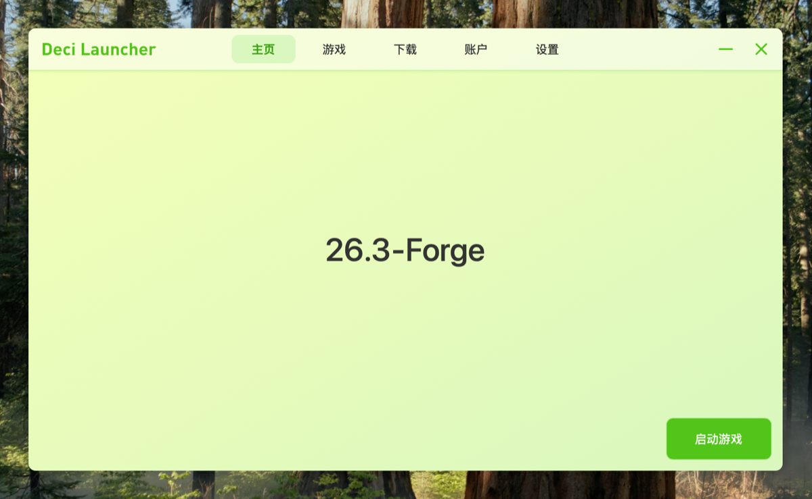

<p align="center">
  
</p>

<h1 align="center">Deci Launcher</h1>

<p align="center">
  <a href="https://github.com/tristanjen/DeciLauncher/actions/workflows/ci.yml">
    
  </a>
  <a href="LICENSE">
    
  </a>
  
  
  
</p>

<p align="center">
  <a href="README.md">English</a> | <strong>简体中文</strong>
</p>

Deci Launcher 是一个轻量、跨平台的 Minecraft 启动器，使用 **C#/.NET 10 + Photino.NET** 构建后端，**Vue 3 + Tailwind CSS + Reka UI** 构建界面。它专注于「扫描本机已安装的游戏版本 → 选择 Java → 启动游戏」这条核心路径，提供原生透明窗口、离线账户、崩溃分析和完全本地的运行方式。

> 当前处于 **Beta** 阶段，版本号见 [`DeciLauncher.csproj`](DeciLauncher.csproj) 的 `<Version>`。

<p align="center">
  
</p>

## 功能特性

### 启动与实例

- **已安装版本扫描** — 读取 `.minecraft/versions/`，识别原版以及 Fabric / Forge / NeoForge / Quilt 等模组版本。
- **版本隔离** — 版本目录自带 `mods/` 或 `saves/` 时，游戏数据隔离在该版本目录内；否则与官方启动器一样共享 `.minecraft` 根目录。
- **分阶段启动进度** — 启动按钮实时显示阶段：解析版本 → 查找 Java → 启动 → 等待游戏窗口。
- **取消启动 / 关闭游戏** — 启动过程中可取消；游戏运行中可单独关闭游戏进程。
- **关启动器不关游戏** — 关闭启动器只取消尚未完成的启动流程，已在运行的游戏会继续；只有「关闭游戏」会结束它。
- **崩溃分析** — 游戏异常退出时解析最新崩溃报告，按内存、显卡驱动、Mod 冲突、Java 版本等方向给出中文/英文解释，并附带游戏输出尾部。

### Java 与账户

- **Java 自动检测** — 扫描 `JAVA_HOME`、系统标准 JDK 目录（macOS 的 `/Library/Java/JavaVirtualMachines`、Linux 的 `/usr/lib/jvm` 等）以及 `PATH`，自动匹配最合适的 Java；手动选择过低版本时给出警告。
- **离线账户** — 创建、选择和删除离线账户，UUID 由用户名确定性生成；账户保存在本地。
- **账户持久化** — 账户列表与备份文件原子写入，损坏时自动回退到 `.bak`。

### 界面与体验

- **原生透明窗口** — 无边框自定义标题栏，Windows / macOS 上透明背景与圆角卡片；`--opaque` 可回退为不透明窗口。
- **绿色极简主题** — 统一的 Tailwind CSS 设计语言与 `deci-*` 语义 token、过渡动画和轻量布局。
- **中英文界面** — 内置 `zh-CN` / `en-US`，可在设置中切换。
- **单实例保护** — 重复启动会提示「已经在运行」并退出，避免两个实例同时操作同一 `.minecraft`。
- **窗口拖拽 / 最小化 / 关闭** — 均由前端标题栏通过消息桥驱动。

### 安全与隐私

- **仅本机监听** — Release 模式下前端由内嵌 Kestrel 提供，只绑定 `127.0.0.1` 的随机端口。
- **访问令牌** — 首次导航需要 URL token，校验后下发独立的 HttpOnly 会话 cookie；无凭据请求一律 404。
- **无遥测** — 不收集、不上传任何数据；日志只写入本机，滚动保留 3 份。
- **本地消息桥** — 前端与后端通过 Photino 的原生消息通道通信，不开放公网端口。

### 发布形态

- **自包含单文件** — 各平台产物均自带 .NET 运行时，无需用户安装 .NET。
- **Windows** — 单文件 `.exe`（x64 / arm64）。
- **Linux** — `.deb`、`.rpm`、`.AppImage`（x64 / arm64）。
- **macOS** — `.app` + `.dmg`（x64 / arm64，DMG 内含 `Applications` 快捷方式）。

## 当前限制

- **下载页尚在开发中** — 「下载」页面目前显示「施工中」。启动器只扫描并启动本机已安装的版本，不提供图形化的版本下载/安装页面。设置中的「下载源」选项已为后续下载/补全功能预留（BMCLAPI 镜像 / 官方源）。
- **仅离线账户** — 暂不支持 Microsoft 账户登录。
- **Beta** — 版本矩阵、界面与行为仍可能调整；发布前请先备份重要数据。
- **macOS 未签名/未公证** — CI 产出的 `.app`/`.dmg` 未做 Developer ID 签名与 notarization，首次打开可能被 Gatekeeper 拦截；本地从源码构建的产物不受此影响。

## 下载

- [GitHub Releases](https://github.com/tristanjen/DeciLauncher/releases) — 已发布的版本。
- [GitHub Actions](https://github.com/tristanjen/DeciLauncher/actions/workflows/ci.yml) — 每次提交由 CI 生成六平台构建产物（需登录 GitHub 下载）。

> Releases 中的版本可能落后于当前源码；最新构建请查看 Actions。

也可以从源码构建，见下方[开发指南](#开发指南)。

## 系统要求

| 平台 | 最低版本 | 架构 |
|------|---------|------|
| Windows | Windows 10 1809（17763）及以上，推荐 Windows 11 | x64、arm64 |
| macOS | macOS 15 Sequoia 及以上 | x64（Intel）、arm64（Apple Silicon） |
| Linux | Ubuntu 22.04+ / Debian 12+ / Fedora 42+，需提供 WebKitGTK 4.1 | x64、arm64 |

- 不支持 32 位系统。
- 以上下限参考 .NET 10 支持矩阵与 Photino 使用的 WebView 组件（WebView2 / WKWebView / WebKitGTK）；macOS 14 及更早版本已不在 .NET 10 官方支持范围内。
- Linux 需要系统提供 `libwebkit2gtk-4.1` 与 GTK 3；Debian/Ubuntu 安装包中已声明依赖。
- **Java 不随启动器分发**：请自行安装 Java 运行时（Java 8 / 17 / 21 等，按游戏版本选择），启动器会扫描并匹配。
- **需要已安装的游戏版本**：首次使用前，请用官方启动器或其他工具在 `.minecraft/versions/` 下安装至少一个版本。

## 快速开始

1. 安装 Java 运行时（Temurin、Zulu、Oracle JDK 等均可）。
2. 准备一个包含 `versions/` 的 `.minecraft` 目录（官方启动器默认目录即可）。
3. 启动 Deci Launcher：
   - Windows/Linux：默认使用可执行文件同级的 `.minecraft`（便携模式）；如不存在，可在「游戏」页点击「浏览」选择目录。
   - macOS：默认使用 `~/.decilc/.minecraft`；同样可在「游戏」页切换目录。
4. 在「账户」页创建离线账户。
5. 在「游戏」页选择版本，回到首页点击「启动游戏」。

## 配置与数据目录

| 内容 | Windows | macOS / Linux |
|------|---------|----------------|
| 账户、日志、单实例锁 | `%AppData%\.decilc\` | `~/.config/.decilc/` |
| 默认游戏目录 | 可执行文件同级的 `.minecraft/`（便携） | macOS：`~/.decilc/.minecraft/`；Linux：可执行文件同级的 `.minecraft/`（便携） |

Linux 通过 `.deb` / `.rpm` / `.AppImage` 安装时，可执行文件通常位于系统目录（例如 `/usr/lib/decilauncher`），请在「游戏」页把实例目录改为 `~/.minecraft` 或其他可写目录。

日志文件为 `logs/latest.log`，并滚动保留 `latest.1.log`、`latest.2.log`。若配置目录不可写，会回退到可执行文件同级的 `logs/`。

> 旧版 macOS 配置目录 `~/Library/Application Support/.decilc/` 会在首次启动时自动迁移账户文件（`accounts.json` 与 `.bak`）到 `~/.config/.decilc/`。

## 命令行参数

| 参数 | 说明 |
|------|------|
| `--opaque` | 以不透明窗口启动（排查用）。窗口没有内容时请先试这个 |

环境变量 `DECILAUNCHER_OPAQUE=1` 与 `--opaque` 等效。

macOS 上 Photino 未原生实现透明窗口，启动器会在窗口创建后通过 AppKit 补齐透明属性；若显示异常仍可用 `--opaque` 回退。

## 故障排查

### 窗口空白或完全透明

1. 先看日志（见下方路径），它会记录启动停在哪一步。
2. 用 `--opaque`（或 `DECILAUNCHER_OPAQUE=1`）启动：若此时能显示界面，说明问题出在透明窗口的渲染路径。
3. 若仍然空白，退出启动器并删除 WebView2 数据目录后重试：
   - Windows：`%LOCALAPPDATA%\DeciLauncher\EBWebView`

### 提示「Deci Launcher 已经在运行」

同一时间只允许运行一个实例。关闭另一个实例后重试。关闭启动器不会结束已经在运行的游戏。

### 找不到 Java

- 确认已安装 Java，并且 `JAVA_HOME` 或 `PATH` 指向有效的 JDK/JRE。
- 在「设置 → 游戏设置」点击「扫描」重新检测；也可以手动选择 Java。
- 部分 Minecraft 版本要求特定 Java 大版本（例如 1.17+ 需要 Java 17+），请按版本准备。

### 找不到已安装的实例

- 确认「游戏」页顶部的实例目录指向正确的 `.minecraft`。
- 确认 `<实例目录>/versions/` 下存在至少一个版本目录，且其中包含对应的 JSON 文件。
- 下载页尚在开发中，当前不会自动安装版本。

### macOS 提示无法打开或已损坏

CI 构建的 `.app`/`.dmg` 未签名、未公证。可在 Finder 中右键选择「打开」，或从源码本地构建后运行；正式分发需要 Developer ID 签名与 notarization。

### 日志位置

| 平台 | 路径 |
|------|------|
| Windows | `%AppData%\.decilc\logs\latest.log` |
| macOS / Linux | `~/.config/.decilc/logs/latest.log` |

### 关闭启动器后游戏仍在运行

这是有意设计：关闭启动器不会中断玩家正在进行的游戏，只有「关闭游戏」按钮会结束游戏进程。

## 开发指南

### 环境要求

- [.NET 10 SDK](https://dotnet.microsoft.com/download/dotnet/10.0)
- [Node.js](https://nodejs.org/) **22.12+**（Vite 8 / Vitest 5 的要求，CI 使用 Node 22）
- [pnpm](https://pnpm.io/) 10+
- Java 运行时（仅运行游戏时需要）

### 调试运行

Debug 模式通过 Vite 开发服务器加载前端，需要先启动 `pnpm dev`：

```bash
# 终端 1：前端开发服务器（默认 127.0.0.1:5173）
cd UserInterface
pnpm install --frozen-lockfile
pnpm dev

# 终端 2：启动 .NET 后端
dotnet run --project DeciLauncher.csproj
```

Release 模式会把前端构建产物嵌入程序集，由 Kestrel 在 `127.0.0.1` 的随机端口提供，不依赖 Vite。

### 测试与检查

```bash
# 后端测试（xUnit v4 + Microsoft.Testing.Platform，配置见 global.json）
dotnet test -c Release

# 前端测试
cd UserInterface && pnpm test

# 类型检查（vue-tsc）
cd UserInterface && pnpm type-check

# 前端构建
cd UserInterface && pnpm build

# 版本一致性：package.json 必须与 csproj <Version> 同步
node UserInterface/scripts/check-version.mjs
```

> 后端测试使用 .NET 10 的 MTP 模式（`global.json` 中 `test.runner = Microsoft.Testing.Platform`）。xUnit v3 3.x 使用的 VSTest 模式在 .NET 10 SDK 下已不再支持。

### 发布与打包

```bash
# 发布单个 RID（显式指定 csproj；裸 dotnet publish 会解析 slnx 并尝试发布测试项目）
dotnet publish DeciLauncher.csproj -c Release -r osx-x64

# 一键发布：前端 + 当前平台可构建的全部 RID + ZIP
./publish.ps1

# macOS DMG（需要已有 DeciLauncher.app）
./packaging/make-dmg.sh \
  "Release/DeciLauncher.app" \
  "Release/DeciLauncher-1.0.0-beta.2-osx-x64.dmg" \
  "Deci Launcher"
```

CI（[`.github/workflows/ci.yml`](.github/workflows/ci.yml)）在六平台矩阵上执行：

- 前端：`pnpm install --frozen-lockfile` → `pnpm test` → 版本检查 → `pnpm build`
- 后端：`dotnet build -c Release` → `dotnet test -c Release` → 各 RID 发布
- 打包：Windows `.exe`、Linux `.deb` / `.rpm` / `.AppImage`、macOS `.app` / `.dmg`

macOS 的 `.app` 由 CI 组装 `Info.plist`、`AppIcon.icns` 并注入版本；DMG 由 `packaging/make-dmg.sh` 生成（600×320 窗口、图标居中、含 `/Applications` 快捷方式）。

### 项目结构

| 路径 | 说明 |
|------|------|
| `Program*.cs` | 后端入口与 partial class 拆分（启动、窗口、账户、Java、游戏扫描、崩溃分析等） |
| `Launching/` | 纯函数启动组件（参数模板、native 匹配、路径映射、WebView 参数等） |
| `UserInterface/` | Vue 3 + Tailwind CSS + Reka UI 前端（Vite、Vitest） |
| `DeciLauncher.Tests/` | xUnit v4 测试 |
| `packaging/` | 图标、Info.plist、DMG 打包脚本 |
| `.github/workflows/ci.yml` | 前端/后端/六平台发布与打包 |
| `publish.ps1` | 本地一键发布脚本 |
| `CLAUDE.md` | 面向开发代理的项目约定与注意事项 |

更详细的代码约定、UI 技能路由和平台不变量见 [`CLAUDE.md`](CLAUDE.md)。

## 贡献

欢迎提交 Issue 和 Pull Request：

- [报告 Bug / 提出功能建议](https://github.com/tristanjen/DeciLauncher/issues)
- Fork 仓库并通过 Pull Request 提交改动

提交前请确保：

- `dotnet test -c Release` 与 `pnpm test` 通过；
- `pnpm type-check` 与 `pnpm build` 通过；
- 用户可见文案同时更新 `src/i18n/zh-CN.ts` 与 `en-US.ts`；
- 没有引入 shadcn，样式使用 Tailwind CSS 与 `src/assets/main.css` 中的 `deci-*` 设计 token。

## 使用的开源项目

| 项目 | 用途 | 许可证 |
|------|------|--------|
| [.NET](https://github.com/dotnet/runtime) | 运行时与 SDK | MIT |
| [ASP.NET Core](https://github.com/dotnet/aspnetcore) | 内嵌静态文件服务器 | MIT |
| [Photino.NET](https://github.com/tryphotino/photino.NET) | 跨平台桌面窗口 | Apache-2.0 |
| [MinecraftLaunch](https://github.com/Lunova-Studio/MinecraftLaunch) | Minecraft 启动核心 | MIT |
| [Vue](https://github.com/vuejs/core) | 前端框架 | MIT |
| [Vite](https://github.com/vitejs/vite) | 前端构建工具 | MIT |
| [Tailwind CSS](https://github.com/tailwindlabs/tailwindcss) | 原子化 CSS 框架 | MIT |
| [Reka UI](https://github.com/unovue/reka-ui) | 无头可访问 UI 原语 | MIT |
| [TypeScript](https://github.com/microsoft/TypeScript) | 类型化 JavaScript | Apache-2.0 |
| [xUnit](https://github.com/xunit/xunit) | 测试框架 | Apache-2.0 |
| [pnpm](https://github.com/pnpm/pnpm) | 包管理器 | MIT |

## 免责声明

- 本项目与 Mojang Studios、Microsoft 无任何关联。
- Minecraft 是 Mojang Studios 的商标；本项目不包含、也不分发 Minecraft 游戏本体、资源文件或账户。
- 请使用自己合法拥有的游戏文件与 Java 运行时；离线账户仅用于本地单人/局域网场景。
- 使用本软件产生的任何后果由使用者自行承担。

## 许可证

[GPL-3.0](LICENSE)
